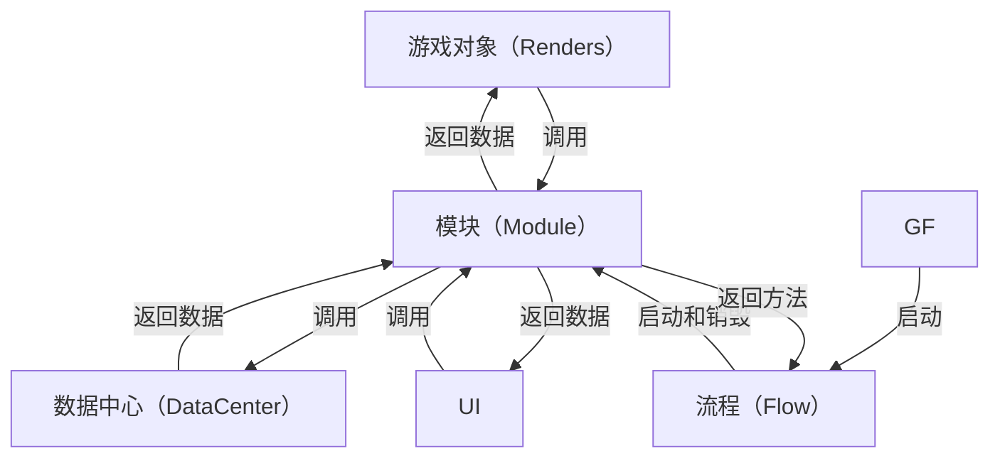
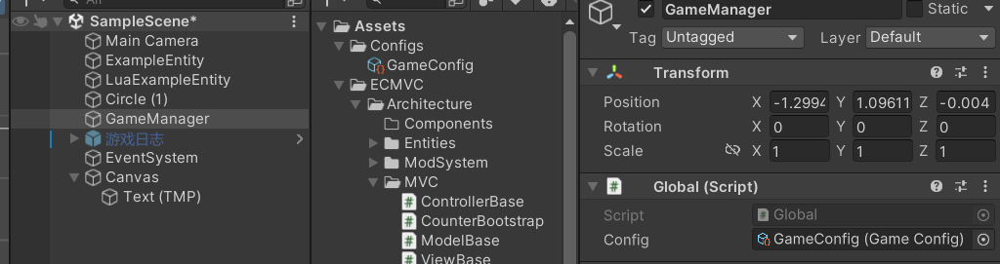
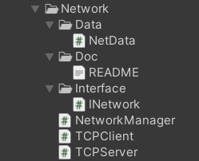

# 基础思想
- 模块解耦
- 顺序可控
- 数据逻辑分离

## 流程图

## 全局（Global）
全局脚本有GF、GameConfig和DataCenter

### GF(GameFramework)
- 模块的控制中心，所有模块都在这里进行创建、运算和销毁
- 其他脚本通过`GF.xxxManager`来访问模块

需要将GF脚本挂在GameManager上


### GameConfig
- 用于存放全局配置，如分辨率、帧率等
- 具体可以参考`Assets\Example\Scripts\GameConfig.cs`

### DataCenter
- 用于管理全局的动态数据，全局唯一
- 所有数据中心都要在这里注册，后续才能被正常获取和使用
- 可以在这里指定启动数据中心
- 具体可以参考`Assets\FModa\Architecture\Data\DataManager.cs`

## 模块（Module）
模块内部高内聚，用命名空间分开，写一个接口暴露所有这个模块可用属性和方法，模块需要做到从这个项目移动到另一个项目完全不会报错
每个模块单独文件夹

模块内部由
- 1个独立数据结构（NetData）
- n个模块主要逻辑
- 1个模块管理器（NetworkManager）
- 1个模块接口（INetwork）
- 1个介绍文档（README.md）

组成，所有类都需要放在同一个**命名空间**下

模块管理器集成模块接口和`IModule`接口，如果该模块管理器需要挂载到游戏中，可以按需继承`MonoBehaviour`。
模块是中枢，渲染器、UI都必须通过模块来获取数据，而不能单独访问数据中心。可以写`Init()`让flow调用来实现初始化。
例子：`Assets/Example/Scripts/Modules/Unit/UnitManager.cs`

### 启动
由流程来启动模块，主要使用订阅发布模式
``` csharp
    public void Enter()
    {
        Debug.Log("进入 ExampleFlow");
        //激活模块
        RAManager=GF.GetModule<UnitManager>();
        //订阅模块事件
        RAManager.OnFlowEnd += ()=>
        {
            GF.flowManager.SwitchFlow<EndFlow>(this);
        };
    }
```

## 流程（Flow）
### 启动
在GF的`Awake`方法中，可以指定启动流程
``` csharp
    void Awake()
    {
        //启动第一个流程,这里指定启动ExampleFlow
        flowManager.StartFlow<ExampleFlow>();
    }
```

### 设计
流程类继承接口`IFlow`
流程的作用是使用`GF.GetModule<XXManager>();`启用模块、决定整个程序的执行顺序
在流程结束切换流程，具体可参考`Assets/Example/Scripts/Flows/ExampleFlow.cs`

## 数据（Data）

### 数据结构
- 用于设计指定的数据结构，继承`IData`接口
- 具体可以参考`Assets/Example/Scripts/Modules/Unit/Data/UnitData.cs`

### 数据中心（DataCenter）
- 用于保存和管理指定类型的数据，继承`IDataCenter`接口
- 具体可以参考`Assets/Example/Scripts/Modules/Unit/Data/UnitDataCenter.cs`

### 泛型数据中心
- 对于使用次数少，不想专门设计一个数据中心的数据，可以使用泛型数据中心
- 具体可以参考`Assets\FModa\Architecture\Global\GenericTable.cs`

### 数据管理器
- 用于管理全局的动态数据，全局唯一
- 所有数据中心都要在这里注册，后续才能被正常获取和使用
- 可以在这里指定启动数据中心
- 具体可以参考`Assets\FModa\Architecture\Data\DataManager.cs`

### 使用
使用`DataManager`来获取数据中心,例如`DataManager.Unit;`//获取单位数据中心

## 渲染器
- 渲染类只用于视图相关的操作，例如动画、输入事件等，不含物理逻辑
- 用事件和逻辑类解耦
- 放在游戏对象上
- 渲染类是正常的MonoBehaviour，继承`MonoBehaviour`即可，其更新机制和普通MonoBehaviour一致，每帧刷新，不使用Tick
- 具体可以参考`Assets/Example/Scripts/Renders/Unit/Units.cs`

## UI
- 和渲染器大致类似，但是继承`UIWidget`
- 放在UI上
- 具体可以参考`Assets\Example\Scripts\UI\UnitHpPanel.cs`

## 内置工具
- 内置工具都位于菜单栏的Tool处，目前有接口自动生成工具，将要生成接口的类托进入即可自动生成接口