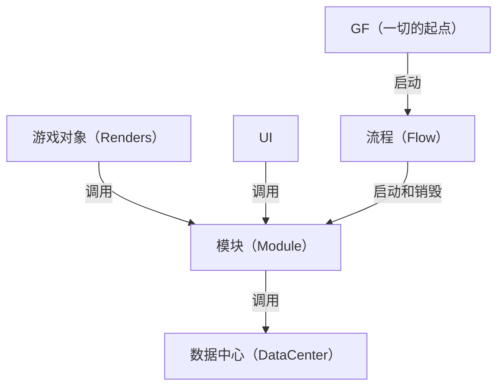
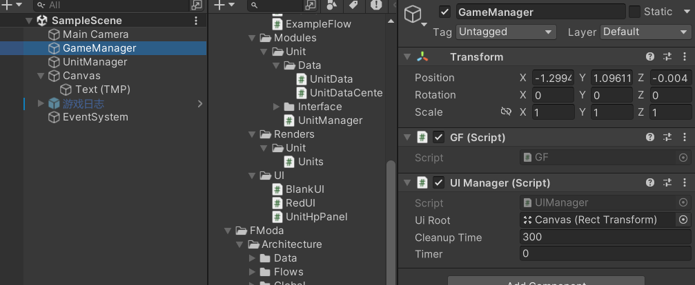
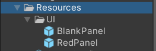

# 基础思想
- 模块解耦
- 顺序可控
- 数据逻辑分离

## 流程图
### 各概念对应关系

- GF与流程：GF负责启动第一个流程，流程全局**有且只有一个**是在运行状态
- 流程与模块：一对多，一个流程可以同时启动多个模块，流程负责模块之间的互动和数据交换
- 模块与数据：一对一，一个模块对应一个数据中心，模块负责从数据中心获取数据，**只予许**模块直接访问数据中心，理论上一个模块可以接多个数据中心，但我不建议这么做
- 渲染、UI与模块：多对一，游戏对象和UI可以随时获取模块来进行操作，或者间接获取数据中心的数据
## 全局（Global）
全局部分有GF、GameConfig，以及数据（Data）部分的数据管理器DataManager

### GF(GameFramework)
- 模块的控制中心，所有模块都在这里进行创建、运算和销毁
- 其他脚本通过`GF.xxxManager`来访问模块

需要将GF脚本挂在GameManager上


### GameConfig
- 用于存放全局配置，如分辨率、帧率等
- 具体可以参考`Assets/FModa/Architecture/Global/GameConfig.cs`，实例放在`Assets/Resources/GameConfig.asset`

## 模块（Module）
模块内部高内聚，用命名空间分开，写一个接口暴露所有这个模块可用属性和方法，模块需要做到从这个项目移动到另一个项目完全不会报错
每个模块单独文件夹

模块内部由
- 1个独立数据结构（NetData）
- n个模块主要逻辑
- 1个模块管理器（NetworkManager）
- 1个模块接口（INetwork）
- 1个介绍文档（README.md）

组成，所有类都需要放在同一个**命名空间**下

模块管理器集成模块接口和`IModule`接口，如果该模块管理器需要挂载到游戏中，可以按需继承`MonoBehaviour`。
模块是中枢，渲染器、UI都必须通过模块来获取数据，而不能单独访问数据中心。可以写`Init()`让flow调用来实现初始化。
例子：`Assets/Example/Scripts/Modules/Unit/UnitManager.cs`

> ⚠️ `IModule`的生命周期方法必须写成`public`。私有成员不参与接口映射，写`void OnDestroy()`（默认private）不会实现`IModule.OnDestroy`，而接口有默认空实现，编译器**不会报错**，方法永远调不到。
>
> 订阅数据中心的事件请放在`OnAwake`里，不要放在Unity的`Awake()`消息里——Unity的`Awake()`和`GF.Awake()`的相对顺序是未定义的，而`OnAwake`由GF主动调用，时序确定。
>
> 订阅用命名方法，不要用lambda：lambda每次求值都是新委托，退订时`-=`匹配不上。

### 启动
由流程来启动模块，主要使用订阅发布模式
``` csharp
    public void Enter()
    {
        Debug.Log("进入 ExampleFlow");
        //激活模块
        RAManager=GF.GetModule<UnitManager>();
        //订阅模块事件
        RAManager.OnFlowEnd += ()=>
        {
            GF.flowManager.SwitchFlow<EndFlow>(this);
        };
    }
```

### 内置模块
#### Debug模块
位置：`Assets/FModa/Modules/Debug`
用途：用于在Game中查看Debug信息

#### 网络模块
位置：`Assets/FModa/Modules/Network`
用途：用于网络通信，制作联机游戏，协议为tcp协议

#### 热更新模块
位置：`Assets/FModa/Modules/Hotfix`
用途：用于热更新，使用xlua作为热更新引擎

#### 输入模块
位置：`Assets/FModa/Modules/Input`
用途：用于管理和获取输入，支持键鼠、手柄、触摸屏三种输入方式，支持使用轮询或事件来传递输入

#### 多语言模块
位置：`Assets/FModa/Modules/Multilingual`
用途：用于多语言支持，内置支持中文、英文、繁体、日语、韩语等多种语言，可自己添加新支持语言，支持自动切换语言

#### 寻路模块
位置：`Assets/FModa/Modules/Pathfinding`
用途：用于单位寻路，使用的是开源的NavMeshPlus


## 流程（Flow）
### 启动
在GF的`Awake`方法中，可以指定启动流程
``` csharp
    void Awake()
    {
        //启动第一个流程,这里指定启动ExampleFlow
        flowManager.StartFlow<ExampleFlow>();
    }
```

### 设计
流程类继承接口`IFlow`
流程的作用是使用`GF.GetModule<XXManager>();`启用模块、决定整个程序的执行顺序
在流程结束切换流程，具体可参考`Assets/Example/Scripts/Flows/ExampleFlow.cs`

## 数据（Data）

### 数据结构
- 用于设计指定的数据结构，继承`IData`接口
- 具体可以参考`Assets/Example/Scripts/Modules/Unit/Data/UnitData.cs`

### 数据中心（DataCenter）
- 用于保存和管理指定类型的数据，继承泛型基类`DataCenter<T>`
- 基类已经提供了增删改查、自增id、`HasId`和三个生命周期事件，子类只需要补自己的语义方法
- 子类参考`Assets/Example/Scripts/Modules/Unit/Data/UnitDataCenter.cs`
- 基类参考`Assets/FModa/Architecture/Data/DataCenter.cs`

### 数据生命周期事件
- 数据中心在**添加成功、移除成功、清空之前**会广播`OnDataAdded`/`OnDataRemoved`/`OnCleared`
- 视图不一定知道自己的数据是被谁删掉的，靠这三个事件才能知道自己已经失效
- 数据中心只广播事实，不替视图做处置；由模块转发成业务事件，视图只订阅模块
- 订阅方参考`Assets/Example/Scripts/Renders/Unit/Units.cs`，转发方参考`Assets/Example/Scripts/Modules/Unit/UnitManager.cs`

### 数据管理器
- 用于管理全局的动态数据，全局唯一
- 所有数据中心都要在这里注册，后续才能被正常获取和使用
- 可以在这里指定启动数据中心
- 具体可以参考`Assets\FModa\Architecture\Data\DataManager.cs`

### 使用
使用`DataManager`来获取数据中心,例如`DataManager.Unit;`//获取单位数据中心

## 渲染器（Renders）
- 渲染类只用于视图相关的操作，例如动画、输入事件等，不含物理逻辑
- 用事件和逻辑类解耦
- 放在游戏对象上
- 渲染类是正常的MonoBehaviour，继承`MonoBehaviour`即可，其更新机制和普通MonoBehaviour一致，每帧刷新，不使用Tick
- 具体可以参考`Assets/Example/Scripts/Renders/Unit/Units.cs`
- 架构内置对象池，只需要继承`Poolable`即可使用，具体可以参考`Assets\Example\Scripts\Renders\Unit\PoolUnit.cs`

## UI
- 和渲染器大致类似，但是继承`UIBase`
- 放在UI上
- 具体可以参考`Assets/Example/Scripts/UI/UnitHpPanel.cs`

### 使用
- 在和GF同一个的游戏对象上放置UIManager（同一个是为了防止切场景时丢失）
- 你可以设置生成的UI生成根节点和清理UI的时机


- 将所有需要生成的UI预制体放在`Assets/Resources/UI`下

- 通过`GF.uiManager.OpenUI("BlankPanel")`即可动态生成UI
- 你可以通过`UIBase.OpenSubUI("RedPanel")`来动态生成子UI
- 关闭的UI不会立刻销毁，会先进关闭列表，超过清理时间才真正销毁；下次打开同名UI会复用
- 勾选`independence`的UI不通过`UIManager`管理
- `OnBind`/`OnUnbind`成对调用，不用自己防重；`OnRefresh`在`OnBind`之后自动调一次，用来做初始同步

## 内置工具
- 内置工具都位于菜单栏的Tools处，目前有接口自动生成工具，将要生成接口的类拖进去即可自动生成接口（菜单：`Tools/Interface Generator`）

## 快速开始

### 0. 场景搭建

需要一个挂载 `GF` 的 GameObject（示例场景里叫 `GameManager`），以及同级一个挂载 `UIManager` 的 GameObject（同级是为了切场景时不丢失）。

`GF.Awake()` 依次完成：单例化 + `DontDestroyOnLoad` → 加载 `Resources/GameConfig` → `DataManager.PreWarm()` → 创建 `FlowManager` → **扫描场景自动注册 `IModule`** → 查找 `UIManager` → 创建 `PoolManager` → 启动首个流程。

> 首个流程目前是在 `GF.cs` 里写死的 `flowManager.StartFlow<ExampleFlow>()`，换成自己的流程改这一行即可。

### 1. 创建一个模块

模块 = 自己的业务接口 + `IModule`。`IModule` 的生命周期方法**全部有默认空实现**，按需重写。

```csharp
public interface IMyManager
{
    void DoSomething();
}

public class MyManager : MonoBehaviour, IMyManager, IModule
{
    public Type InterfaceType => typeof(IMyManager); // 对外暴露哪个接口
    public int Priority => 5;                        // 数字越小越先执行

    public void OnAwake() { }          // 注册时（由 GF 主动调用）
    public void OnStart() { }          // 紧随 OnAwake
    public void OnUpdate() { }         // 每逻辑帧（GF.tick，默认 0.1s）
    public void OnLateUpdate() { }     // 每逻辑帧，OnUpdate 之后
    public void OnDestroy() { }        // 移除模块 / 退出播放
    public void OnApplicationQuit() { }

    public void DoSomething() { }
}
```

> ⚠️ **生命周期方法必须写 `public`。** C# 中私有成员不参与接口映射，写 `void OnDestroy()`（默认 private）不会实现 `IModule.OnDestroy`，编译器因为有默认实现（DIM）而**静默不报错**，方法永远不会被调用。

**注册与获取**

```csharp
GF.RegisterModule<MyManager>(myManager);  // 注册已有实例（按 typeof(MyManager) 存）
GF.CreateModule<MyManager>();             // 创建并注册（MonoBehaviour 会自动建 GameObject）
var m = GF.GetModule<MyManager>();        // 获取；不存在时自动创建并注册
GF.HasModule<MyManager>();                // 是否已注册
GF.RemoveModule<MyManager>();             // 移除并触发 OnDestroy
GF.ClearAllModules();                     // 清空（切场景时用，逆序触发 OnDestroy）
```

- 场景里挂好的 `IModule` 组件会被 `AutoRegisterSceneModules()` 自动注册，无需手写注册代码
- 模块按**接口类型**存在 `_moduleMap` 里，另外维护了一张「具体类型 → 接口类型」的反查表，所以通过具体类型获取是官方用法
- ⚠️ **用具体类型获取，不要用业务接口获取。** `GetModule<T>` 的约束是 `where T : class, IModule`，而业务接口（如 `IUnitManager`）**不继承** `IModule`，所以 `GF.GetModule<IUnitManager>()` 根本编译不过 —— 写 `GF.GetModule<UnitManager>()`
- `Priority` 决定同一个逻辑帧内的执行顺序；`GetModule` 的自动创建路径会用模块自己的 `Priority`
- ⚠️ `RegisterModule` 用 `typeof(T)` 当 key，而 `CreateModule` / `GetModule` / 场景自动注册用的是 `module.InterfaceType`。对同一个实例两种方式各注册一次会得到两条记录，生命周期钩子也就跑两遍 —— 场景里的模块**让它自动注册就行，别再手写 `RegisterModule`**

### 2. 创建一个数据结构

纯数据类，实现标记接口 `IData`。

```csharp
[System.Serializable]
public class UnitData : IData
{
    public int maxHp;
    public int hp;
    public float moveSpeed;
}
```

### 3. 创建一个数据中心

继承泛型基类 `DataCenter<T>`，按需补充自己的语义方法。

```csharp
public class UnitDataCenter : DataCenter<UnitData>, IDataCenter
{
    public void UpdateUnitData(long id, int hp = -1)
    {
        if (datas.TryGetValue(id, out var data)) data.hp = hp;  // datas 是 protected
    }
}
```

在 `DataManager` 中按懒加载属性注册：

```csharp
// DataManager.cs
private static UnitDataCenter _unit;
public static UnitDataCenter Unit => _unit ??= new UnitDataCenter();
```

> 模块里**不要缓存** `DataManager.Unit` 到字段 —— `DataManager.PreWarm()` 会整体替换实例，缓存的引用会变成孤儿。

**`DataCenter<T>` 提供的 API**

| 成员 | 说明 |
|------|------|
| `long AddData(T)` | 添加并返回自增 id；`null` 返回 `-1` |
| `T GetData(long)` | 取数据；不存在打 `LogError` 并返回 `null` |
| `Dictionary<long, T> GetAllData()` | 返回内部字典本体（非拷贝） |
| `void UpdateData(long, T)` | 整体替换某条数据 |
| `bool RemoveData(long)` | 删除，返回是否真的删掉了 |
| `void Clear()` | 清空全部数据并把 id 计数归零 |
| `bool HasId(long)` | 该 id 是否存在 |
| `bool HasData(long)` / `bool HasData(T)` | 是否存在且非空 / 是否包含该对象 |
| `long GetId(T)` | 反查 id，找不到返回 `-1` |
| `protected Dictionary<long, T> datas` | 子类可直接读写的存储 |
| `protected long id` | 自增 id 计数 |

> `GetData` 返回的是**引用**，直接改它的字段不会触发任何事件（`UnitDataCenter.UpdateUnitData` 就是这么做的）。需要广播就自己 `Invoke` 事件。

### 4. 创建一个渲染器

普通 `MonoBehaviour`，每帧 `Update`，**不走模块的逻辑帧 Tick**。

```csharp
public class Units : MonoBehaviour
{
    private IUnitManager unitManager;
    private long unitId;

    void Start()
    {
        unitManager = GF.GetModule<UnitManager>();
        unitId = unitManager.Register(new UnitData { maxHp = 100, hp = 100, moveSpeed = 2 });
    }

    void Update()
    {
        if (Input.GetKey(KeyCode.W)) transform.Translate(unitManager.Move(unitId));
    }

    void OnDestroy()
    {
        unitManager.UnRegister(unitId);
    }
}
```

上面是最小形态。真实项目里渲染器**还必须订阅数据生命周期事件**，否则数据被别的路径删掉时它会变成孤儿 —— 完整版本见 `Assets/Example/Scripts/Renders/Unit/Units.cs`。

**对象池**：需要池化的对象继承 `Poolable`，用 `GF.Spawn` / `GF.Despawn` 而不是 `Instantiate` / `Destroy`。

```csharp
public class PoolUnit : Poolable
{
    public override void ActionOnRelease(GameObject go)  // 回收时要重置状态
    {
        base.ActionOnRelease(go);
        go.GetComponent<PoolUnit>().lifeTimer = 0f;
    }
}

var go = GF.Spawn(prefab, position, rotation, parent);
GF.Despawn(go);
```

`GF.Spawn` 会检查预制体上有没有 `Poolable`：有就走对象池，没有就直接 `Instantiate`。池的大小由 `Poolable` 上的 `defaultCapacity` / `maxSize` 控制。

### 5. 创建一个 UI

继承 `UIBase`，实现 `OnBind` / `OnUnbind`，可选 `OnRefresh`。

```csharp
public class UnitHpPanel : UIBase
{
    [SerializeField] private TextMeshProUGUI _text;
    private IUnitManager unitManager;

    protected override void OnBind()    { unitManager = GF.GetModule<UnitManager>();
                                          unitManager.OnHpChanged += RefreshAll; }
    protected override void OnUnbind()  { unitManager.OnHpChanged -= RefreshAll; }
    protected override void OnRefresh() { RefreshAll(); }

    private void RefreshAll() { /* 从模块拿数据刷文本 */ }
}
```

`UIBase` 的生命周期：`OnEnable` → `OnBind()` + `OnRefresh()`；`OnDisable` / `OnDestroy` → `OnUnbind()`。`_isBound` 标志保证成对出现，不用自己防重。

- **预制体放 `Assets/Resources/UI/` 下**，用 `GF.uiManager.OpenUI("BlankPanel")` 动态创建
- `OpenSubUI("RedPanel")` 开子 UI，父 UI 关闭时会级联关闭子 UI
- 关闭的 UI 不会立刻销毁，而是进 `uiCloses`，超过 `cleanupTime`（默认 300s）才真正 `Destroy`，下次 `OpenUI` 同名会直接复用
- `independence = true` 的 UI 不通过 `UIManager` 管理

> ⚠️ 渲染器和 UI **只订阅模块暴露的事件**，不要直接订阅 `DataManager.XXX`。直接订阅会绕过模块，视图与数据的耦合就没有中间层兜底了。

### 6. 创建一个流程

```csharp
public class MyFlow : IFlow
{
    private IUnitManager unitManager;

    public void Enter()
    {
        unitManager = GF.GetModule<UnitManager>();
        unitManager.Init();
        unitManager.OnFlowEnd += () => GF.flowManager.SwitchFlow<EndFlow>(this);
    }

    public void Update() { }   // 每个逻辑帧，由 GF 调用
    public void Exit() { GF.RemoveModule<UnitManager>(); }
}
```

`IFlow` 的 `Enter` / `Update` / `Exit` 都有默认空实现。流程的职责是**启用模块、编排模块之间的互动、决定整个程序的执行顺序**；切换流程用 `GF.flowManager.SwitchFlow<T>(当前流程)`，它会先调当前流程的 `Exit()`。

---