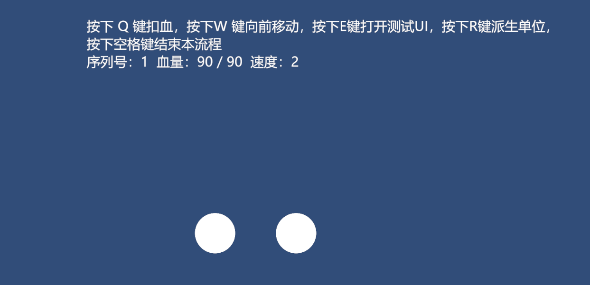

## 播放时序
当你点击播放时，你会发现明明有两个物体，但是上面的血量只显示1个，但当你点下 `Q`键时，又会有两个

在这个示例中，整个流程的播放时序为
### Awake阶段
GF.Awake():加载GameConfig
-->初始化数据中心
-->自动注册挂载在场景中的模块
-->获取UI管理器
-->创建对象池
-->获取游戏对象管理器
-->启动第一个流程
-->激活模块并初始化
-->注册并实例化一个圆形对象
-->触发UnitHpPanel的数据更新

GameObjectManager.Awake()：扫描整个场景，获取场景游戏对象

### OnEnable阶段
UnitHpPanel.OnEnable():绑定方法触发，触发数据更新

### Start阶段
Units.Start()：初始化并注册数据到数据中心

由此可见，在整个初始化的过程中，UnitHpPanel的数据更新触发了两次，且两次更新都发生在场景中的那个圆形对象之前，在手动实例化的圆形对象之后，所以才会出现上面的情况。
因此，如果你想改善这个问题，有两个办法：一个是在ExampleFlow中手动手动注册场景中的游戏对象，另一个是将触发时机移动到Awake()。

## 框架用法
请查看`Assets/FModa/README/README.md`[FMode使用教程](..\..\..\FModa/README/README.md)