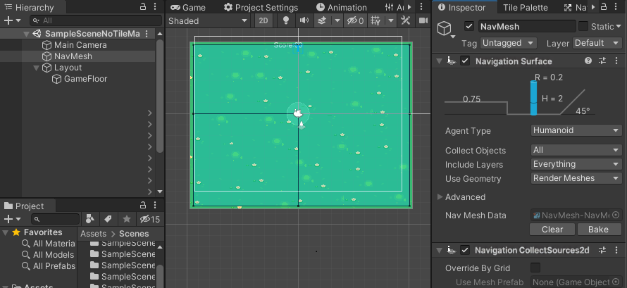
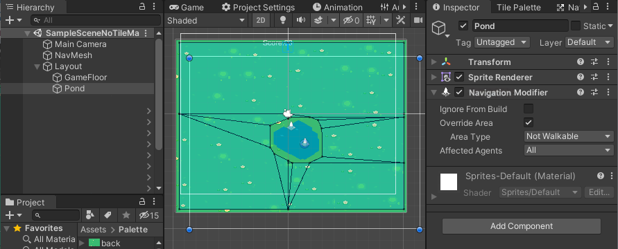
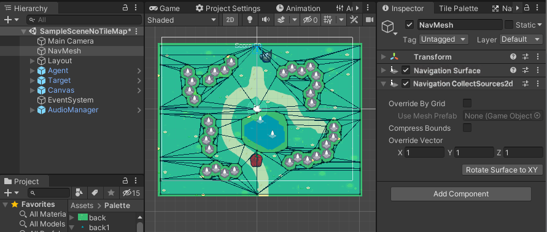

## NavMeshPlus
开源地址：[here](https://github.com/h8man/NavMeshPlus)

### 使用方式
- 创建一个名为“Layout”的新根，我们将在这里存储关卡布局，并将子节点添加为“GameFloor”。把任意`SpriteRenderer`放到“GameFloor”上，现在在对象中添加组件`NavigationModifier`标记为导航源。 添加新对象并选中“NavMesh”对象，在检查器中点击并选择`NavigationSurface` 。如果你点击烘焙，什么都不会发生，因为我们需要添加另一个组件`NavigationCollectSources2d`，点击`Rotate Surface to XY`，然后点击`Bake`烘焙。

- 现在在“Layout”里添加一个对象，叫它“Pool”，放入新的精灵，同样点击选择一个`NavigationModifier`组件。在该组件上勾选`Override Area`，将`Area Type`改为`Not Walkable` 。现在再按一次`Bake`（在“NavMesh”对象内）。你应该看到“Pool”是从航海区划出来的。

- 此时，你可以添加带有`NavMeshAgent`组件的GameObject，这些组件能够与你的NavMesh交互（即行走）。
- 默认情况下，组件通常会在你按下播放键时旋转。这可能是不理想的（比如你的物体可能被旋转远离视野平面，从而变得隐形），所以你应该通过在新脚本或已有脚本中添加类似的设置来修正它的旋转：
```csharp
    NavMeshAgent agent;
    void Start()
    {
        agent = GetComponent<NavMeshAgent>();
        agent.updateRotation = false;
        agent.updateUpAxis = false;
    }

    void Update()
    {
        if (Input.GetMouseButtonDown(0))
        {
            Ray ray = Camera.main.ScreenPointToRay(Input.mousePosition);
            var point = ray.origin;
            point.z = 0;
            agent.destination = point;
        }
    }
```
