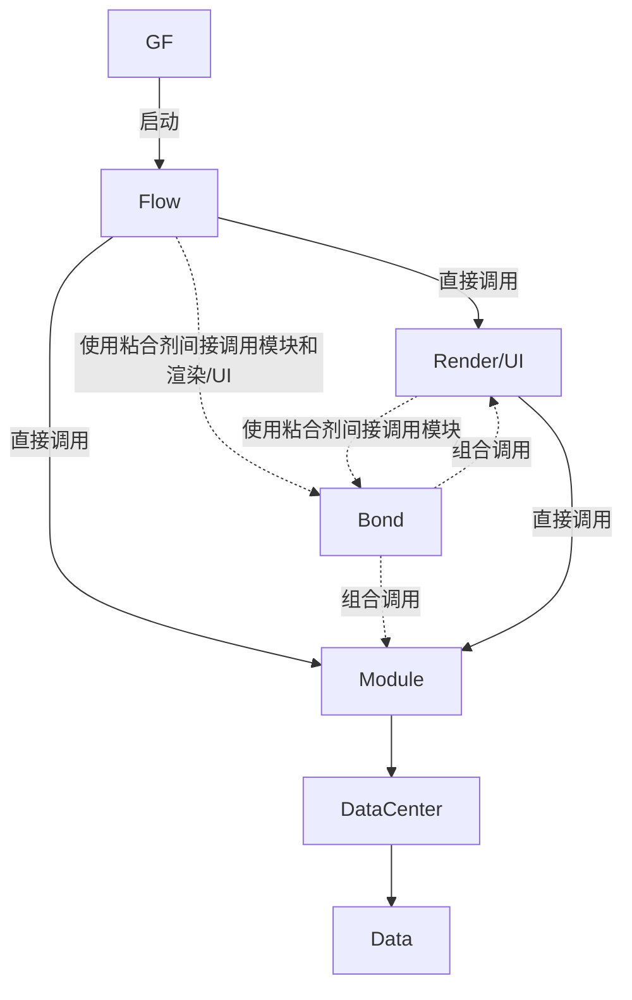
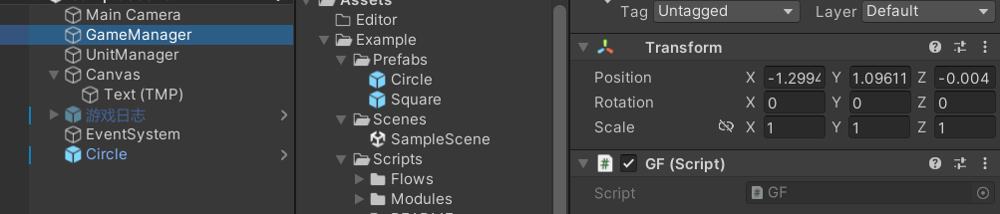
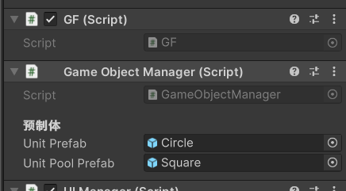

# FModa 使用说明

## 基础思想

- 模块解耦
- 顺序可控
- 数据逻辑分离
- 跨层粘合复用

## 架构流程图
直线：主要环节
虚线：可选环节



- **GF 与 Flow**：GF 启动第一个流程，全局有且只有一个 `CurrentFlow`。
- **Flow 与 Bond**：Flow 决定步骤顺序和流程切换，可以直接管理单个模块；多模块协作以及模块与 Render / UI 的组合交互由 Bond 实现。
- **Bond 与其他层**：Bond 处理模块间及模块与 Render / UI 间的可复用交互，有权访问模块、渲染和 UI。
- **Module 与 DataCenter**：只有模块可以直接访问数据中心，模块负责业务规则和业务事件。
- **Render / UI**：自身输入和显示可以调用模块；涉及其他模块或其他视图的组合动作交给 Bond。
- **PM**：只放与模块无关的纯静态工具方法，不是公共业务代码的收纳处。

上层可以依赖下层，下层不能反向依赖上层。模块需要通知外部时使用事件；任何层都不能把流程切换实现塞进 Module、Bond、Render 或 UI，**切换流程的实现代码只能写在 Flow 中**。

---

## 全局（Global）

全局部分包括 GF、GameConfig、GameEnum、PM；动态数据中心统一由 `DataManager` 注册。

### GF（GameFramework）

GF 是全局入口，负责：

- 模块注册、获取、移除和生命周期派发；
- Bond 创建、获取与按类型复用；
- 逻辑帧、第一个 Flow、对象池、UI 和场景对象管理入口。

常用参数：

- `tick`：模块逻辑帧间隔，默认 0.1 秒。
- `startFlowName`：启动游戏时自动启动的第一个流程。
- `testMode`：是否启用模拟数据初始化。
- `debugMode`：是否输出 GF 日志。

GF 需要挂在 `GameManager` 上，并与 `GameObjectManager`、`UIManager` 放在同一个 GameObject。



日志使用 `GF.Log / GF.LogWarning / GF.LogError`，不要直接 `Debug.Log`。

### GameConfig

- **所有静态数据的唯一位置**：`Assets/FModa/Architecture/Global/GameConfig.cs`。
- 实例位于 `Assets/Resources/GameConfig.asset`，运行时通过 `GF.config.xxx` 读取。
- 每个字段必须用注释或 `[Tooltip]` 写明用途、使用者和取值含义。
- 不要另建配置类、常量类或 `public static` 数据类。

### GameEnum

- **所有公用枚举的唯一位置**：`Assets/FModa/Architecture/Global/GameEnum.cs`，命名空间 `FModa.Enum`。
- 不要在各模块 Data 中重复定义同语义枚举，再编写转换适配器。

### PM

- **纯静态工具方法的唯一位置**：`Assets/FModa/Architecture/Global/PM.cs`，统一使用 `PM.xxx(...)`。
- 只允许与模块无关的计算、格式化、无状态算法等纯工具方法。
- 不得访问或依赖 Module、DataCenter、Bond、Flow、Render、UI。
- 卡牌变单位、单位变卡牌、生成实体、刷新 UI 等公共业务代码不属于 PM，应放 Bond。
- 不要再新建 `Utils / Helper / Common / Extensions` 等静态工具类。

---

## 粘合剂（Bond）

### 职责

Bond 用来解决「这段组合逻辑很多流程都需要，但放 Flow 会臃肿、放 PM 又会依赖模块」的问题。

适合放入 Bond 的内容：

- 多个模块之间的数据交换和业务动作组合；
- 卡牌变单位、单位变卡牌等跨模块转换；
- 生成 Render、向模块注册数据、把 id 注入 Render、刷新相关 UI；
- 需要多个流程复用的模块初始化或清理步骤；
- 对外转发一个流程结束请求事件。

Bond 不负责：

- 决定整个 Flow 的步骤顺序；
- 实现 `GF.flow.SwitchFlow` 等流程切换；
- 替代 Module 内部单一领域的业务规则；
- 存放与模块无关的数学或格式化工具，后者放 PM。

### 获取与复用

```csharp
var unitBond = GF.GetBond<UnitBond>();
```

- `GF.GetBond<T>()`：不存在时自动创建，同一具体类型重复获取会复用实例。
- `GF.CreateBond<T>()`：显式创建；已存在时返回已有实例并输出警告。
- Bond 实现 `FModa.Bond.IBond`，具体类型按业务领域放在游戏侧 `Bond/` 目录。
- Bond 应提供无参构造；依赖在使用步骤中获取，不要在构造函数里依赖 Flow。

### 示例

`Assets/Example/Scripts/Bond/Unit/UnitBond.cs` 的 `SpawnUnit(...)` 将以下动作封装为一个可复用步骤：

1. 通过 `GF.Spawn` 生成单位 Render；
2. 调用 `UnitManager.Register` 注册数据；
3. 调用 `Units.BindUnit(id)` 注入 id；
4. 取得 `UnitHpPanel` 并触发刷新。

Flow 只调用 `unitBond.SpawnUnit(...)`，不自己实现这些细节。

`SwitchFlowBond` 只提供 `OnFlowEnd` 事件和 `FlowEnd()` 触发方法。真正的 `GF.flow.SwitchFlow<EndFlow>(this)` 仍必须在 Flow 中实现。

---

## 模块（Module）

模块内部高内聚，使用独立命名空间，通过接口暴露业务能力。模块应能整体移动到另一个项目，而不引用其他业务模块或 `Assets/Example`。

标准结构：

```text
Modules/Network/
├── Data/NetData.cs
├── Interface/INetwork.cs
├── NetworkManager.cs
├── TCPClient.cs / TCPServer.cs
└── Doc/README.md
```

模块管理器实现业务接口和 `IModule`；需要 Inspector 引用时可同时继承 `MonoBehaviour`。只有模块可以访问数据中心。

参考：`Assets/Example/Scripts/Modules/Unit/UnitManager.cs`。

### 生命周期规则

- `IModule` 生命周期方法必须写成 `public`。
- 销毁钩子是 **`OnRemove()`**，不是 `OnDestroy()`。
- 订阅数据中心事件放在 `OnAwake`，不要放在 Unity 的 `Awake()`。
- 使用命名方法订阅，并在 `OnRemove()` 成对退订。
- MonoBehaviour 模块的 `OnRemove()` 与 Unity `OnDestroy()` 可能都执行，清理逻辑必须幂等。
- 模块不直接引用其他模块的具体实现，跨模块协作交给 Bond。
- 只涉及一个模块时，Flow 可以直接调用模块的 `Init()`；初始化同时组合多个模块或 Render / UI 时，由 Bond 调用。

### 启动与清理

场景挂载的模块由 GF 自动注册，不要再手写 `RegisterModule`。纯逻辑模块由实际使用者通过 `GF.GetModule<ConcreteManager>()` 获取，不存在时自动创建。

单模块的准备和清理由 Flow 或其他实际使用者直接处理；涉及多个模块或模块与 Render / UI 的组合准备和清理时，应封装在 Bond 的 `Prepare / Cleanup` 等步骤中。多语言等全局基础服务可以按需获取，不必随每个 Flow 移除。

---

## 流程（Flow）

### 固定契约

流程实现 `IFlow`：

```csharp
public void Enter(IFlow lastFlow, List<object> list = null);
public void Update();
public void Exit();
```

- `lastFlow`：上一流程，首次启动为 `null`。
- `list`：上一流程传递的数据，可以为 `null`。
- 三个方法都没有默认实现，必须全部写出；没有逻辑帧步骤时 `Update()` 留空。

GF 根据 `startFlowName` 启动第一个流程，也可以在代码中使用：

```csharp
GF.flow.StartFlow<ExampleFlow>();
```

### Flow 能做什么

- 直接创建、获取、初始化、调用和移除单个模块；
- 在 `Enter / Update / Exit` 中按顺序执行单模块操作并调用 Bond；
- 订阅 Module 或 Bond 的流程相关事件，并在 `Exit()` 退订；
- 在自定义切换处理方法中调用 `GF.flow.SwitchFlow` 或 `SwitchSceneAndFlow`；
- 使用 `lastFlow` 和 `list` 决定后续步骤。

### Flow 不能做什么

- 不在 Flow 中协调多个模块，或将模块操作与 Render / UI 组合；
- 不直接操作 Render、UI 或 `GF.sgo`；
- 不实现卡牌与单位转换、实体生成并联动视图、跨模块数据交换、UI 刷新等粘合逻辑；
- 不添加与流程切换无关的自定义帮助方法。

```csharp
public class TestFlow : IFlow
{
    private TestManager testManager;

    public void Enter(IFlow lastFlow, List<object> list = null)
    {
        testManager = GF.GetModule<TestManager>();
        testManager.OnFinished += HandleFinished;
    }

    public void Update() { }

    public void Exit()
    {
        testManager.OnFinished -= HandleFinished;
        GF.RemoveModule<TestManager>();
        testManager = null;
    }

    // 唯一允许的自定义方法：流程切换
    private void HandleFinished()
    {
        GF.flow.SwitchFlow<NextFlow>(this);
    }
}
```

---

## 数据（Data）

### 数据结构

- 实现 `IData`，只描述状态。
- 不放 MonoBehaviour、业务判断、模块调用或事件转发。
- 参考 `Assets/Example/Scripts/Modules/Unit/Data/UnitData.cs`。

### 数据中心

- 继承 `DataCenter<T>`，用于保存和管理指定类型的数据。
- 基类提供增删改查、合成 id、`HasId` 等能力，子类只补语义方法。
- 当前基类没有 `OnDataAdded / OnDataRemoved / OnCleared` 事件；需要通知时在具体数据中心或模块中显式定义。
- 查询优先使用 `TryGetData`；展示合成 id 的本地序号时使用 `ToLocalId(id)`。

### 数据管理器

所有数据中心都在 `Assets/FModa/Architecture/Data/DataManager.cs` 注册。模块每次通过 `DataManager.X` 属性访问，不要缓存到字段，因为 `PreWarm()` 会替换实例。

Render / UI 不得直接访问 `DataManager`；Bond 也不直接读写数据中心，而是通过模块完成数据和视图的组合。

---

## 渲染器（Render）

- 负责动画、Transform、输入轮询等表现，不直接修改数据。
- 普通 Render 继承 `MonoBehaviour`，可以每帧 `Update`。
- 自身输入和查询可以调用模块；跨模块或跨层组合调用 Bond。
- 场景对象和预制体通过 `GF.sgo` 获取，不使用 `GameObject.Find / FindObjectOfType`。
- 参考 `Assets/Example/Scripts/Renders/Unit/Units.cs`。

### 对象池

频繁生成和回收的对象继承 `Poolable`，统一使用 `GF.Spawn / GF.Despawn`。回收时重写 `ActionOnRelease`、调用 `base` 并重置所有可变状态。

参考 `Assets/Example/Scripts/Renders/Unit/PoolUnit.cs`。

### 游戏对象管理器

- `GameObjectManager` 与 GF 挂在同一个对象上。
- 预制体在 Inspector 中登记，通过 `GF.sgo.xxxPrefab` 获取。
- 场景对象挂 `Sgo` 或实现 `ISGO`，设置唯一 `SgoId`，通过 `GF.sgo.gameObjects["ID"]` 获取。
- Flow 不直接执行这些装配细节；涉及模块与视图组合时由 Bond 使用。




---

## UI

- UI 面板必须继承 `UIBase`，不能直接继承 `MonoBehaviour`。
- 预制体放在 `Assets/Resources/UI/`，通过 `GF.ui.OpenUI("预制体名")` 打开。
- 不手动 `Instantiate`、注册或 `AddComponent<UIBase>`。
- `OnBind / OnUnbind` 成对订阅和退订；`OnRefresh` 用于初始同步。
- 自身按钮和显示可以调用模块；跨模块、跨视图组合调用 Bond。
- 关闭的 UI 会进入复用列表，超过清理时间才销毁。
- 参考 `Assets/Example/Scripts/UI/UnitHpPanel.cs`。

`UIManager` 与 GF 放在同一个 GameObject，避免切场景时丢失。


---

## 内置模块

实现新功能前先检查并复用：

| 模块 | 位置 | 用途 |
|---|---|---|
| Debug | `Modules/Debug` | 游戏内日志 |
| Network | `Modules/Network` | TCP 网络通信 |
| Hotfix | `Modules/Hotfix` | XLua 热更新 |
| Input | `Modules/Input` | 键鼠、手柄、触摸输入 |
| Multilingual | `Modules/Multilingual` | 多语言 |
| Pathfinding | `Modules/Pathfinding` | NavMeshPlus 寻路 |
| Modding | `Modules/Modding` | XLua 模组加载 |
| SeedRandom | `Modules/SeedRandom` | 可复现的带种子整型 / 浮点型随机数 |

---

## 快速开始：Bond + Flow 最小示例

### 1. 场景搭建

创建 `GameManager`，添加 `GF`、`GameObjectManager`、`UIManager`，并配置启动流程名。


### 2. 创建模块和数据

```csharp
using System;
using FModa.Data;
using UnityEngine;

public class TestManager : IModule
{
    public Type InterfaceType => typeof(TestManager);
    public int Priority => 5;

    private TestDataCenter Data => DataManager.Test;

    public long Register(TestData data) => Data.AddData(data);
    public void UnRegister(long id) => Data.RemoveData(id);
    public bool TryGetData(long id, out TestData data) => Data.TryGetData(id, out data);

    public Vector3 Move(long id)
    {
        return Data.TryGetData(id, out var data)
            ? new Vector2(0, 1) * Time.deltaTime * data.moveSpeed
            : Vector3.zero;
    }
}

[System.Serializable]
public class TestData : IData
{
    public float moveSpeed;
}

public class TestDataCenter : DataCenter<TestData>
{
}
```

在 `DataManager` 注册数据中心，并按项目 id 规范分配非零 Code：

```csharp
private static TestDataCenter _test;
public static TestDataCenter Test
    => _test ??= new TestDataCenter(DataCenterCodes.Test);
```

### 3. 创建 Bond

```csharp
using FModa.Bond;

public class TestBond : IBond
{
    public long CreateUnitData()
    {
        // Bond 负责 Render 发起的数据注册与后续视图绑定；模块获取可在此按需完成
        var test = GF.GetModule<TestManager>();
        return test.Register(new TestData { moveSpeed = 3 });
    }
}
```

### 4. 创建 Render

```csharp
using UnityEngine;

public class TestUnit : MonoBehaviour
{
    private long unitId = -1;
    private TestManager testManager;

    public void BindUnit(long id) => unitId = id;

    private void Start()
    {
        testManager = GF.GetModule<TestManager>();

        // 静态场景单位的兜底注册也复用 Bond，不在 Render 复制注册规则
        if (unitId == -1)
            BindUnit(GF.GetBond<TestBond>().CreateUnitData());
    }

    private void Update()
    {
        if (unitId <= 0 || !testManager.TryGetData(unitId, out _)) return;
        if (Input.GetKey(KeyCode.W))
            transform.Translate(testManager.Move(unitId));
    }

    private void OnDestroy()
    {
        if (unitId > 0 && testManager != null && testManager.TryGetData(unitId, out _))
            testManager.UnRegister(unitId);
    }
}
```

把 `TestUnit` 挂到场景中的 Sprite 上。动态生成时，应在 Bond 中同时完成 `GF.Spawn`、注册和 `BindUnit`，不要在 Flow 里展开这些步骤。

### 5. 创建 Flow

```csharp
using System.Collections.Generic;

public class TestFlow : IFlow
{
    private TestManager testManager;

    public void Enter(IFlow lastFlow, List<object> list = null)
    {
        GF.Log("进入 TestFlow");

        // 只管理一个模块，Flow 直接获取，无需额外的 Prepare Bond
        testManager = GF.GetModule<TestManager>();
    }

    public void Update() { }

    public void Exit()
    {
        // 只有确需随流程销毁时才移除；全局服务可保留
        GF.RemoveModule<TestManager>();
        testManager = null;
        GF.Log("退出 TestFlow");
    }
}
```

在 GF 的 `startFlowName` 中填入 `TestFlow`。进入 Play 后按 `W`，单位即可移动。


---

## 内置工具

菜单 **Tools > Interface Generator** 可根据 public 成员生成接口声明。生成后检查命名空间、模块生命周期、事件退订和职责归属。

更多架构约束见 `Assets/FModa/Architecture/Skills/README.md`，可运行示例见 `Assets/Example`。
