# 基础思想
- 模块解耦
- 顺序可控
- 数据逻辑分离

## 流程图
### 各概念对应关系
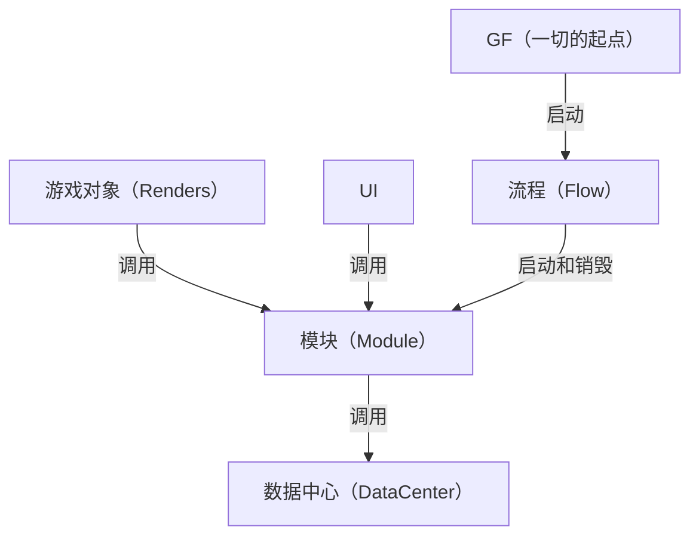
- GF与流程：GF负责启动第一个流程，流程全局**有且只有一个**是在运行状态
- 流程与模块：一对多，一个流程可以同时启动多个模块，流程负责模块之间的互动和数据交换
- 模块与数据：一对一，一个模块对应一个数据中心，模块负责从数据中心获取数据，**只予许**模块直接访问数据中心，理论上一个模块可以接多个数据中心，但我不建议这么做
- 渲染、UI与模块：多对一，游戏对象和UI可以随时获取模块来进行操作，或者间接获取数据中心的数据

上层是可以依赖下层的，但是下层不能有任何对上层的依赖！就目前而言，**数据层是最底层的，中间则是模块层，上层则为渲染层**，模块通过持有数据层来调用对应数据，渲染层也通过持有模块来调用模块层的数据，**flow层不被包含在这三层之中，这三层都不能持有flow层，但flow层却能持有模块层和渲染层**。如果有模块层想要调用渲染层或flow层，请在模块中用`事件`来解决；如果渲染层想要调用flow层，请通过模块层的`事件`来解决。
GF是所有层通用的，所有层都可以调用GF，但是不要在GF中调用其他层！
## 全局（Global）
全局部分有GF、GameConfig，以及数据（Data）部分的数据管理器DataManager

### GF(GameFramework)
- 模块的控制中心，所有模块都在这里进行创建、运算和销毁
- 其他脚本通过`GF.xxxManager`来访问模块

参数说明：
- `Tick`：逻辑帧间隔，模块层每隔多少秒执行一次
- `startFlowName`：启动游戏时自动启动的第一个流程
- `testMode`：测试模式下会自动调用SimulatedData.Init()进行模拟数据初始化，主要用于单元测试

需要将GF脚本挂在GameManager上
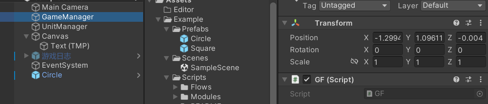

### GameConfig
- 用于存放全局配置，如分辨率、帧率等
- 具体可以参考`Assets/FModa/Architecture/Global/GameConfig.cs`，实例放在`Assets/Resources/GameConfig.asset`

### 公共枚举（GameEnum）
- 用于定义公共枚举，以消除模块间单独定义枚举而造成的需要二次转换的问题
- 所有的数据都可以获取公共枚举

## 模块（Module）
模块内部高内聚，用命名空间分开，写一个接口暴露所有这个模块可用属性和方法，模块需要做到从这个项目移动到另一个项目完全不会报错
每个模块单独文件夹
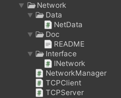
模块内部由
- 1个独立数据结构（NetData）
- n个模块主要逻辑
- 1个模块管理器（NetworkManager）
- 1个模块接口（INetwork）
- 1个介绍文档（README.md）

组成，所有类都需要放在同一个**命名空间**下

模块管理器集成模块接口和`IModule`接口，如果该模块管理器需要挂载到游戏中，可以按需继承`MonoBehaviour`。
模块是中枢，渲染器、UI都必须通过模块来获取数据，而不能单独访问数据中心。可以写`Init()`让flow调用来实现初始化。
例子：`Assets/Example/Scripts/Modules/Unit/UnitManager.cs`

> ⚠️ `IModule`的生命周期方法必须写成`public`。私有成员不参与接口映射，写`void OnDestroy()`（默认private）不会实现`IModule.OnDestroy`，而接口有默认空实现，编译器**不会报错**，方法永远调不到。
>
> 订阅数据中心的事件请放在`OnAwake`里，不要放在Unity的`Awake()`消息里——Unity的`Awake()`和`GF.Awake()`的相对顺序是未定义的，而`OnAwake`由GF主动调用，时序确定。
>
> 订阅用命名方法，不要用lambda：lambda每次求值都是新委托，退订时`-=`匹配不上。

### 启动
由流程来启动模块，主要使用订阅发布模式
``` csharp
    public void Enter()
    {
        Debug.Log("进入 ExampleFlow");
        //激活模块
        RAManager=GF.GetModule<UnitManager>();
        //订阅模块事件
        RAManager.OnFlowEnd += ()=>
        {
            GF.flowManager.SwitchFlow<EndFlow>(this);
        };
    }
```

### 内置模块
#### Debug模块
位置：`Assets/FModa/Modules/Debug`
用途：用于在Game中查看Debug信息

#### 网络模块
位置：`Assets/FModa/Modules/Network`
用途：用于网络通信，制作联机游戏，协议为tcp协议

#### 热更新模块
位置：`Assets/FModa/Modules/Hotfix`
用途：用于热更新，使用xlua作为热更新引擎

#### 输入模块
位置：`Assets/FModa/Modules/Input`
用途：用于管理和获取输入，支持键鼠、手柄、触摸屏三种输入方式，支持使用轮询或事件来传递输入

#### 多语言模块
位置：`Assets/FModa/Modules/Multilingual`
用途：用于多语言支持，内置支持中文、英文、繁体、日语、韩语等多种语言，可自己添加新支持语言，支持自动切换语言

#### 寻路模块
位置：`Assets/FModa/Modules/Pathfinding`
用途：用于单位寻路，使用的是开源的NavMeshPlus


## 流程（Flow）
### 启动
在GF的`Awake`方法中，可以指定启动流程
``` csharp
    void Awake()
    {
        //启动第一个流程,这里指定启动ExampleFlow
        flowManager.StartFlow<ExampleFlow>();
    }
```

### 设计
流程类继承接口`IFlow`
流程的作用是使用`GF.GetModule<XXManager>();`启用模块、决定整个程序的执行顺序
在流程结束切换流程，具体可参考`Assets/Example/Scripts/Flows/ExampleFlow.cs`

## 数据（Data）

### 数据结构
- 用于设计指定的数据结构，继承`IData`接口
- 具体可以参考`Assets/Example/Scripts/Modules/Unit/Data/UnitData.cs`

### 数据中心（DataCenter）
- 用于保存和管理指定类型的数据，继承泛型基类`DataCenter<T>`
- 基类已经提供了增删改查、自增id、`HasId`和三个生命周期事件，子类只需要补自己的语义方法
- 子类参考`Assets/Example/Scripts/Modules/Unit/Data/UnitDataCenter.cs`
- 基类参考`Assets/FModa/Architecture/Data/DataCenter.cs`

### 数据生命周期事件
- 数据中心在**添加成功、移除成功、清空之前**会广播`OnDataAdded`/`OnDataRemoved`/`OnCleared`
- 视图不一定知道自己的数据是被谁删掉的，靠这三个事件才能知道自己已经失效
- 数据中心只广播事实，不替视图做处置；由模块转发成业务事件，视图只订阅模块
- 订阅方参考`Assets/Example/Scripts/Renders/Unit/Units.cs`，转发方参考`Assets/Example/Scripts/Modules/Unit/UnitManager.cs`

### 数据管理器
- 用于管理全局的动态数据，全局唯一
- 所有数据中心都要在这里注册，后续才能被正常获取和使用
- 可以在这里指定启动数据中心
- 具体可以参考`Assets\FModa\Architecture\Data\DataManager.cs`

### 使用
使用`DataManager`来获取数据中心,例如`DataManager.Unit;`//获取单位数据中心

## 渲染器（Renders）
- 渲染类只用于视图相关的操作，例如动画、输入事件等，不含物理逻辑
- 用事件和逻辑类解耦
- 放在游戏对象上
- 渲染类是正常的MonoBehaviour，继承`MonoBehaviour`即可，其更新机制和普通MonoBehaviour一致，每帧刷新，不使用Tick
- 具体可以参考`Assets/Example/Scripts/Renders/Unit/Units.cs`

### 对象池
- 架构内置对象池，只需要继承`Poolable`即可使用，具体可以参考`Assets\Example\Scripts\Renders\Unit\PoolUnit.cs`
- 请确保你的所有实例化和销毁都用的是`GF.Spawn`和`GF.Despawn`，这两个方法会根据游戏对象是否存在`Poolable`来决定是否使用对象池

### 游戏对象管理器
- 请把`GameObjectManager`添加到和`GF`同一个对象上
- 对于场景中的游戏对象和预制体，你可以用`GameObjectManager`来进行管理，具体可以参考`Assets\Example\Scripts\Flows\ExampleFlow.cs`
- 对于预制体，你可以在`GameObjectManager`中手动添加游戏对象来实现，然后在代码中用`GF.sgo.xxxPrefab`来进行引用
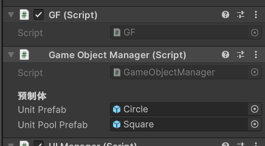

- 如果你想引用场景中的游戏对象，你可以给他们添加一个接口`ISGO`,然后实现其接口内容，你需要手动填入一个唯一的ID，然后就可以通过`GF.sgo.gameObjects["UnitHpPanel"].GetComponent<UnitHpPanel>()`获取到这个游戏对象以及组件了
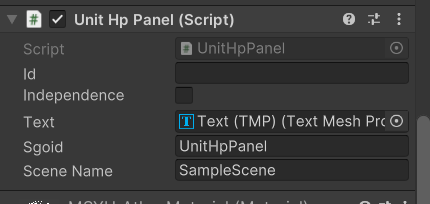

- 如果你不想这么麻烦，还有一个更简单的方式是，直接添加`Sgo`组件
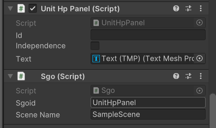

## UI
- 和渲染器大致类似，但是继承`UIBase`
- 放在UI上
- 具体可以参考`Assets/Example/Scripts/UI/UnitHpPanel.cs`

### 使用
- 在和GF同一个的游戏对象上放置UIManager（同一个是为了防止切场景时丢失）
- 你可以设置生成的UI生成根节点和清理UI的时机
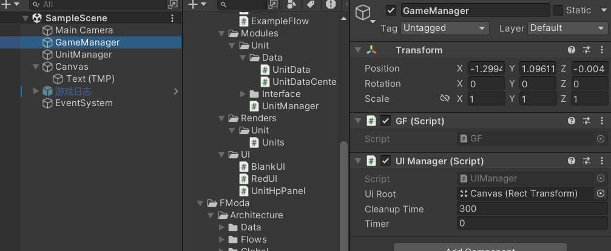

- 将所有需要生成的UI预制体放在`Assets/Resources/UI`下
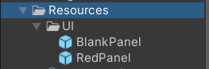
- 通过`GF.uiManager.OpenUI("BlankPanel")`即可动态生成UI
- 你可以通过`UIBase.OpenSubUI("RedPanel")`来动态生成子UI
- 关闭的UI不会立刻销毁，会先进关闭列表，超过清理时间才真正销毁；下次打开同名UI会复用
- 勾选`independence`的UI不通过`UIManager`管理
- `OnBind`/`OnUnbind`成对调用，不用自己防重；`OnRefresh`在`OnBind`之后自动调一次，用来做初始同步

## 内置工具
- 内置工具都位于菜单栏的Tools处，目前有接口自动生成工具，将要生成接口的类拖进去即可自动生成接口（菜单：`Tools/Interface Generator`）

## 快速开始

### 场景搭建
在`Assests/Scenes`创建一个名为`TestScene`的场景，在场景中创建一个空对象，添加一个`GF`组件。

创建一个名为`GameManager`的空对象，添加三个组件：`GF`、`GameObjectManager`、`UIManager`。
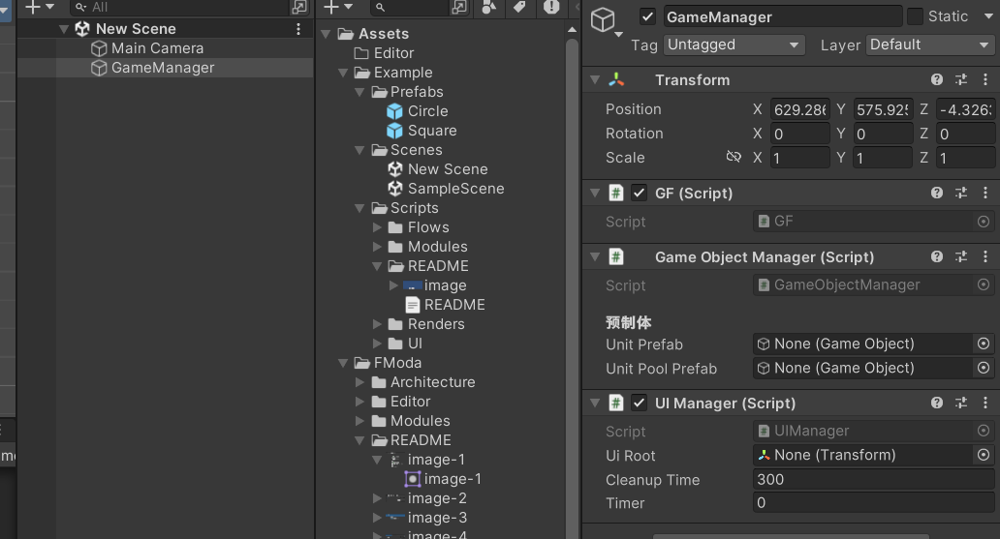

### 创建一个模块
在`Assets/Scripts`下创建`Modules/TestModule`文件夹，在文件夹内创建`TestManager.cs`,键入以下代码

```csharp
using System;
using FModa.Data;
using UnityEngine;

public class TestManager : IModule
{
    public Type InterfaceType => typeof(TestManager);

    public int Priority => 5;
}

```

### 创建一个数据结构
在`Assets/Scripts/Modules/TestModule`下创建`Data`文件夹，在文件夹内创建`TestData.cs`,键入以下代码

```csharp
[System.Serializable]
public class TestData : IData
{
    public float moveSpeed;

    public override IData Clone()
    {
        return new TestData
        {
            moveSpeed = this.moveSpeed
        };
    }
}
```

### 创建一个数据中心

在`Assets/Scripts/Modules/TestModule/Data`下创建`TestDataCenter.cs`,键入以下代码

```csharp
using FModa.Data;

public class TestDataCenter : DataCenter<TestData>
{
}

```

将数据中心注册到`DataManager`中，在`Assets/FModa/Architecture/Data/DataManager.cs`下添加以下代码
```csharp
        //测试数据中心
        private static TestDataCenter _test;
        public static TestDataCenter Test => _test ??= new TestDataCenter();
```

回到`Assets/Scripts/Modules/TestModule/TestManager.cs`模块，键入新代码
```csharp
    //测试数据中心
    private TestDataCenter dataCenter => DataManager.Test;

    /// <summary>
    /// 注册单位
    /// </summary>
    /// <param name="data"></param>
    public long Register(TestData data)
    {
        return dataCenter.AddData(data);
    }

    /// <summary>
    /// 注销单位
    /// </summary>
    /// <param name="id"></param>
    public void UnRegister(long id)
    {
        dataCenter.RemoveData(id);
    }

    /// <summary>
    /// 单位移动
    /// </summary>
    /// <param name="id"></param>
    /// <returns></returns>
    public Vector3 Move(long id)
    {
        return new Vector2(0, 1) * Time.deltaTime * dataCenter.GetData(id).moveSpeed;
    }
```

由此，整个模块构建完成，最后的结构如下
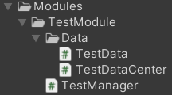


### 创建一个渲染器
在`Assets/Scripts`下创建`Renders/TestUnit`文件夹，在文件夹内创建`TestUnit.cs`,键入以下代码

```csharp
using UnityEngine;

public class TestUnit : MonoBehaviour
{
    public long unitId=-1;
    private TestManager testManager;

    private void Start()
    {
        testManager = GF.GetModule<TestManager>();
        
        //对已经注册的单位不再次注册
        if (unitId!=-1) return;

        //确保单位数据不为空
        //这是仅仅用于初始化，不保存数据，数据都保存在数据中心
        var unitData = new TestData()
        {
            moveSpeed = 3,
        };

        //获取单位模块
        unitId=testManager.Register(unitData); //注册单位
    }

    void OnDestroy()
    {
        testManager.UnRegister(unitId); //注销单位
    }

    void Update()
    {
        if(Input.GetKey(KeyCode.W))
        {
            transform.Translate(testManager.Move(unitId));
        }
    }
}

```

在场景中添加一个`2D Object-->Sprites-->Circle`游戏对象，将 `TestUnit.cs` 组件添加到该游戏对象上
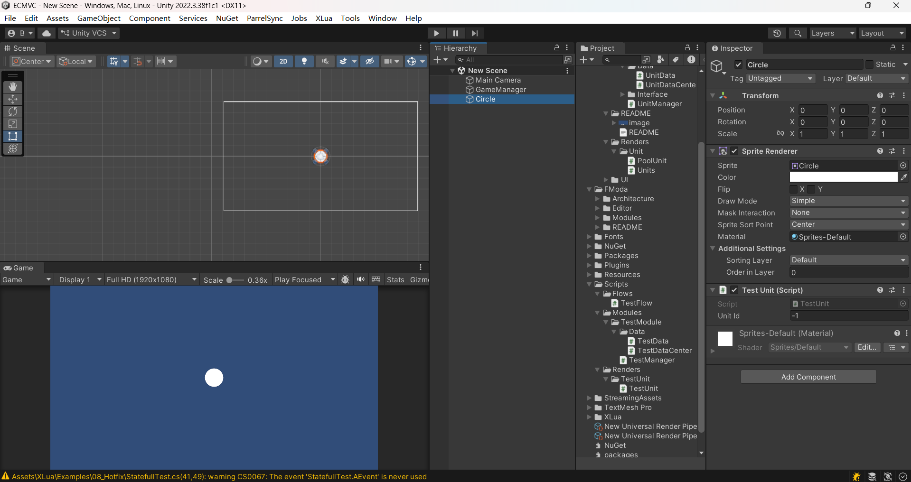

### 创建一个流程
在`Assets/Scripts`下创建`Flow`文件夹，在文件夹内创建`TestFlow.cs`,
键入以下代码
``` csharp
using UnityEngine;

public class TestFlow : IFlow
{
    private TestManager test;
    public void Enter()
    {
        Debug.Log("进入 TestFlow");
        test = GF.CreateModule<TestManager>();
    }

    public void Exit()
    {
        Debug.Log("退出 TestFlow");
    }
}

```

> 在GF的`StartFlowName`键入`TestFlow`即可启动该流程
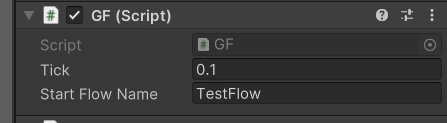

接下来点击`播放键`，你可以按下`W`键，看到游戏对象在移动

最后的Scripts目录结构如下
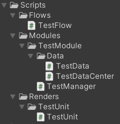

更多的进阶用法可以参考`Assets/Example`