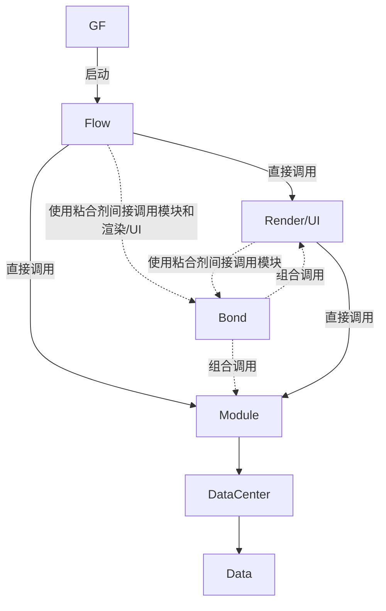

# FModa

**F**low + **Mo**dule + **Da**ta — 一套面向 Unity 的轻量模块化框架。

- 详细使用说明（含截图）：`Assets/FModa/README/README.md`
- 架构规则：`Assets/FModa/Architecture/Skills/README.md`
- 可运行示例：`Assets/Example/`

## 基础思想

- 模块解耦
- 顺序可控
- 数据逻辑分离
- 跨层粘合复用

---

## 核心概念

| 概念 | 类 | 职责 |
|------|-----|------|
| **GF** | `GF` | 全局入口。初始化框架、派发模块生命周期、管理模块与 Bond、提供对象池出入口 |
| **Flow** | `IFlow` / `FlowManager` | 编排流程步骤，可直接管理单个模块；多模块和模块与视图的协作调用 Bond；自定义方法只允许用于切换流程 |
| **Bond** | `IBond` | 粘合剂。封装模块间以及模块与 Render / UI 间的可复用交互，可访问模块、渲染和 UI |
| **Module** | `IModule` | 模块。负责业务规则与业务事件，是数据中心的唯一访问者 |
| **DataCenter** | `DataCenter<T>` | 数据中心。负责运行时数据存储与语义化变更 |
| **PM** | `PM` | 纯静态工具方法。与模块、数据中心、流程、Bond 和视图均无关 |
| **Renders** | `MonoBehaviour` / `Poolable` | 游戏对象。执行和展示、转发输入，不直接访问数据中心 |
| **UI** | `UIBase` / `UIManager` | UI 显示、输入转发与创建/回收 |

### 各概念对应关系

直线：主要环节
虚线：可选环节



- **GF 与 Flow**：GF 启动第一个流程，全局有且只有一个 `CurrentFlow`。
- **Flow 与 Bond**：Flow 决定先做什么、后做什么以及何时切换流程，可以直接管理单个模块；多模块协作和模块与视图的组合交互由 Bond 完成。
- **Bond 与其他层**：卡牌变单位、单位变卡牌、生成实体并同步 UI、组合多个模块能力等代码放在 Bond，供所有流程复用。
- **流程切换**：实现代码只能写在 Flow 中。Bond / Module / Render / UI 可以发事件或返回结果，但不能代替 Flow 调用切换 API。
- **Module 与 DataCenter**：只有模块可以直接访问数据中心；模块不直接引用其他模块的具体实现。
- **Render / UI**：自身显示和输入转发可调用模块；涉及其他模块或其他视图的组合逻辑交给 Bond。

---

## 文件结构

```text
Assets/FModa/                        框架本体
├── Architecture/
│   ├── Global/
│   │   ├── GF.cs                    全局入口：模块 / Bond 管理、优先级派发、对象池出入口
│   │   ├── GameConfig.cs            全局静态数据（ScriptableObject）
│   │   ├── GameEnum.cs              公用枚举
│   │   └── PM.cs                    与模块无关的纯静态工具方法
│   ├── Bond/
│   │   └── IBond.cs                 粘合剂标记接口
│   ├── Data/
│   │   ├── IData.cs                 数据标记接口
│   │   ├── IDataCenter.cs           数据中心标记接口
│   │   ├── DataCenter.cs            泛型数据中心基类
│   │   └── DataManager.cs           所有数据中心的统一注册入口
│   ├── Flows/
│   │   ├── IFlow.cs                 流程接口（Enter / Update / Exit）
│   │   └── FlowManager.cs           流程启动与切换
│   ├── Renders/                     对象池与场景对象管理
│   └── UI/                          UIBase 与 UIManager
└── Modules/                         框架自带的独立模块

Assets/Example/Scripts/
├── Bond/
│   ├── Unit/UnitBond.cs             单位数据、Render 与 UI 的组合步骤
│   └── SwitchFlow/SwitchFlowBond.cs 结束流程请求事件；不执行流程切换
├── Flows/                           ExampleFlow / EndFlow
├── Modules/Unit/                    UnitManager + 接口 + 数据与数据中心
├── Renders/Unit/                    Units / PoolUnit
└── UI/                              UnitHpPanel / BlankUI / RedUI
```

### 模块的目录约定

每个模块单独一个文件夹、使用同一个命名空间：

```text
Modules/Network/
├── Data/NetData.cs
├── Interface/INetwork.cs
├── NetworkManager.cs
├── TCPClient.cs / TCPServer.cs
└── Doc/README.md
```

目标是模块能整体移动到另一个项目而不引用其他业务模块。Bond 按业务领域放在游戏侧 `Bond/` 目录，不塞进模块内部，也不塞进 `PM`。

---

## 职责边界

### Flow：编排步骤，可管理单个模块

`Enter / Update / Exit` 是 `IFlow` 的固定契约，必须全部实现。Flow 可以直接创建、获取、初始化、调用和移除单个模块；多模块协作，以及模块与 Render / UI 的组合交互必须放进 Bond。Flow 不直接操作视图细节，也不为跨模块转换、实体生成并联动 UI 等编写自定义帮助方法。唯一允许的自定义流程方法是流程切换处理，例如 `HandleFlowEnd()`。

### Bond：处理可复用的跨层协作

Bond 可以访问模块、Render 和 UI，封装需要组合它们才能完成的一步业务动作。通过 `GF.GetBond<T>()` 获取，不存在时自动创建，同一具体类型重复获取会复用实例。Bond 不实现 `GF.flow.SwitchFlow`，只通过事件通知 Flow 做切换决定。

### PM：只放纯工具函数

PM 中只允许与模块无关的静态方法，例如数值计算、格式化、无状态算法。不得访问 `GF.GetModule`、`DataManager`、Render / UI、Bond 或 Flow，也不得放卡牌与单位转换等业务粘合代码。

### 数据与视图

- 数据只描述状态，业务规则和事件在 Module 中。
- Render / UI 不直接访问 `DataManager`。
- 模块的 `OnUpdate` / `OnLateUpdate` 按 `GF.tick`（默认 0.1 秒）派发；Render 才使用每帧 `Update` 做表现。
- 顺序由 Flow 的步骤显式决定，模块生命周期由 GF、Flow 和 Bond 按职责处理，不依赖 Unity 消息顺序。

---

## 内置工具

菜单栏 **Tools > Interface Generator** 可按 public 成员生成接口声明。生成后仍需检查命名空间、生命周期方法与事件退订。

## 内置模块

| 模块 | 位置 | 用途 |
|---|---|---|
| Debug | `Assets/FModa/Modules/Debug` | 游戏内日志面板 |
| Network | `Assets/FModa/Modules/Network` | TCP 网络通信 |
| Hotfix | `Assets/FModa/Modules/Hotfix` | XLua 热更新 |
| Input | `Assets/FModa/Modules/Input` | 键鼠、手柄、触摸输入 |
| Multilingual | `Assets/FModa/Modules/Multilingual` | 多语言与语言包 |
| Pathfinding | `Assets/FModa/Modules/Pathfinding` | 基于 NavMeshPlus 的寻路 |
| Modding | `Assets/FModa/Modules/Modding` | XLua 模组加载 |
| SeedRandom | `Assets/FModa/Modules/SeedRandom` | 可复现的带种子整型 / 浮点型随机数 |

实现新功能前先检查内置模块，优先调用或扩展现有能力。

## 依赖

| 依赖 | 用途 | 来源 |
|------|------|------|
| Unity 2022.3 | 运行环境 | — |
| xLua | 热更新管线、Modding 模组加载 | `Assets/XLua`、`Assets/Plugins/xlua.bundle` |
| UniTask | 热更新异步流程 | `Packages/manifest.json` |
| Newtonsoft.Json | 网络消息序列化 | `com.unity.nuget.newtonsoft-json` |
| TextMeshPro | UI 与日志面板文本 | `com.unity.textmeshpro` |
| Microsoft.CodeAnalysis.CSharp | 接口生成器的语法分析 | NuGet，见 `Assets/packages.config` |
| Universal RP | 渲染管线 | `com.unity.render-pipelines.universal` |
