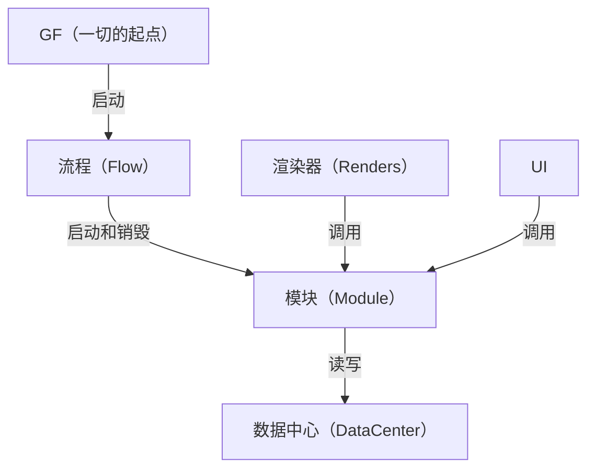

# FModa

**F**low + **Mo**dule + **Da**ta — 一套面向 Unity 的轻量模块化框架。
- 详细使用说明（含截图）：`Assets/Example/README/README.md`
- 可运行的示例工程：`Assets/Example/`

## 基础思想
- 模块解耦
- 顺序可控
- 数据逻辑分离

---

## 核心概念

| 概念 | 类 | 职责 |
|------|-----|------|
| **GF** | `GF` | 全局入口。初始化一切、派发模块生命周期、提供对象池出入口 |
| **Flow** | `IFlow` / `FlowManager` | 流程。启动和销毁模块，游戏运行的总线，顺序可控的基础 |
| **Module** | `IModule` | 模块。负责业务逻辑，是渲染器/UI 与数据之间的唯一中枢 |
| **DataCenter** | `DataCenter<T>` | 数据中心。负责数据存储与变更广播 |
| **Renders** | `MonoBehaviour` / `Poolable` | 游戏对象。执行和展示，不存储数据、不处理逻辑 |
| **UI** | `UIBase` / `UIManager` | UI 显示与创建/回收 |

### 各概念对应关系



- **GF 与流程**：GF 负责启动第一个流程，全局**有且只有一个**流程处于运行状态
- **流程与模块**：一对多。一个流程可以同时启动多个模块，流程负责模块之间的互动和数据交换
- **模块与数据**：一对一。一个模块对应一个数据中心，**只允许**模块直接访问数据中心（理论上一个模块可以接多个数据中心，但不建议）
- **渲染器、UI 与模块**：多对一。游戏对象和 UI 随时获取模块来进行操作，或间接获取数据中心的数据
- **反向回路**（虚线）：数据被增/删/清空时，数据中心广播事件 → 模块翻译成业务语义转发 → 渲染器/UI 才知道自己持有的数据已经没了。详见[数据生命周期事件](#数据生命周期事件反向回路)

---

## 文件结构

```
Assets/FModa/                        框架本体
├── Architecture/
│   ├── Global/
│   │   ├── GF.cs                    全局入口：模块注册 / 优先级派发 / 对象池出入口
│   │   └── GameConfig.cs            全局配置（ScriptableObject）
│   ├── Data/
│   │   ├── IData.cs                 数据标记接口
│   │   ├── IDataCenter.cs           数据中心标记接口 + 创建文档
│   │   ├── DataCenter.cs            泛型数据中心基类：存储 + 生命周期事件
│   │   └── DataManager.cs           所有数据中心的统一注册入口（懒加载）
│   ├── Flows/
│   │   ├── IFlow.cs                 流程接口（Enter / Update / Exit）
│   │   └── FlowManager.cs           流程启动与切换
│   ├── Renders/
│   │   ├── Poolable.cs              对象池对象基类
│   │   └── PoolManager.cs           对象池管理
│   └── UI/
│       ├── UIBase.cs                UI 组件基类（OnBind / OnUnbind / OnRefresh）
│       └── UIManager.cs             UI 创建 / 关闭 / 延迟清理
├── Editor/
│   └── InterfaceGenerator.cs        接口自动生成工具（Tools/Interface Generator）
└── Modules/                         框架自带的独立模块，每个模块自成一体
    ├── IModule.cs                   模块生命周期接口（全默认空实现）
    ├── Network/                     TCP 客户端/服务端 + 主线程派发
    ├── Hotfix/                      xLua 热更新 + AssetBundle 加载 / 资源下载
    ├── Modding/                     Mod 清单扫描与 XLua 模组加载
    └── Debug/                       GameLogger 游戏内日志面板

Assets/Example/                      使用示例（可直接参考、修改）
├── Scenes/SampleScene.unity
├── Prefabs/                         Circle / Square
├── Scripts/
│   ├── Flows/                       ExampleFlow / EndFlow
│   ├── Modules/Unit/                UnitManager + IUnitManager + UnitData + UnitDataCenter
│   ├── Renders/Unit/                Units（示范订阅者）/ PoolUnit（对象池）
│   └── UI/                          UnitHpPanel / BlankUI / RedUI
└── README/README.md                 详细使用说明 + 截图

Assets/Resources/
├── GameConfig.asset                 全局配置实例
└── UI/                              UI 预制体（BlankPanel / RedPanel）
```

### 模块的目录约定

每个模块单独一个文件夹、**同一个命名空间**，内部由这几部分组成：

```
Modules/Network/
├── Data/NetData.cs             1 个独立数据结构
├── Interface/INetwork.cs       1 个模块接口
├── NetworkManager.cs           模块管理器（实现 INetwork + IModule）
├── TCPClient.cs / TCPServer.cs n 个主要逻辑
└── Doc/README.md               1 个介绍文档
```

目标是**模块能从当前项目整个拖到另一个项目而不报错**，所以模块内部不要反向依赖 `Assets/Example/` 里的东西。

---

## 设计原则

### 模块分离

模块直接不应该有任何代码关联，需要强相关的功能建议整合到一个模块中（例如是直接做单位模块，而不是分开做成生命模块、攻击模块），实现高内聚、低耦合。渲染器和 UI 一律通过模块取数据。

### 数据统一

所有数据都放在数据中心里，其他地方一律不存储数据。

### 流程控制

仅用流程来控制整个游戏的运行顺序。

### 逻辑帧与渲染帧分离

模块的 `OnUpdate` / `OnLateUpdate` 按 `GF.tick`（默认 0.1s）派发，而不是每帧；渲染器和 UI 保持普通 `MonoBehaviour` 的每帧 `Update`。需要每帧动画/输入响应就放在渲染器里，别塞进模块。（其实模块也不是不可以用（））

---

## 内置工具

菜单栏 **Tools** 下：

- **Interface Generator**（`Tools/Interface Generator`）—— 把要生成接口的类拖进去，自动按 public 成员生成 `I<类名>.cs`，连同注释一起迁移。生成的是**成员声明**，`IModule` 之外的生命周期方法记得自己补 `public`。

---

### 内置模块
#### Debug模块
位置：`Assets/FModa/Modules/Debug`
用途：用于在Game中查看Debug信息

#### 网络模块
位置：`Assets/FModa/Modules/Network`
用途：用于网络通信，制作联机游戏，协议为tcp协议

#### 热更新模块
位置：`Assets/FModa/Modules/Hotfix`
用途：用于热更新，使用xlua作为热更新引擎

#### 输入模块
位置：`Assets/FModa/Modules/Input`
用途：用于管理和获取输入，支持键鼠、手柄、触摸屏三种输入方式，支持使用轮询或事件来传递输入

#### 多语言模块
位置：`Assets/FModa/Modules/Multilingual`
用途：用于多语言支持，内置支持中文、英文、繁体、日语、韩语等多种语言，可自己添加新支持语言，支持自动切换语言

#### 寻路模块
位置：`Assets/FModa/Modules/Pathfinding`
用途：用于单位寻路，使用的是开源的NavMeshPlus

## 依赖

| 依赖 | 用途 | 来源 |
|------|------|------|
| Unity 2022.3 | 运行环境 | — |
| xLua | 热更新管线、Modding 模组加载 | `Assets/XLua`、`Assets/Plugins/xlua.bundle` |
| UniTask | 热更新异步流程 | `Packages/manifest.json` |
| Newtonsoft.Json | 网络消息序列化 | `com.unity.nuget.newtonsoft-json` |
| TextMeshPro | UI 与日志面板文本 | `com.unity.textmeshpro` |
| Microsoft.CodeAnalysis.CSharp | 接口生成器的语法分析 | NuGet，见 `Assets/packages.config` |
| Universal RP | 渲染管线 | `com.unity.render-pipelines.universal` |
